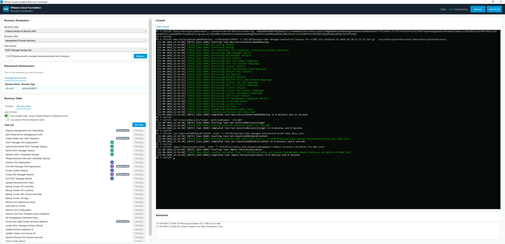

# Recovery Coordinator User Guide

The **VMware Cloud Foundation Recovery Coordinator** is a Windows desktop application, shipped with the
`VCF.RecoveryCoordinator` module, that walks you through recovering a VMware Cloud Foundation instance
from backups. It does not replace the module's PowerShell cmdlets; it runs them for you, in the right
order, in embedded PowerShell consoles, and keeps track of what has finished.

This guide explains every part of the window and takes you through a recovery from start to finish.

## Contents

- [Before you begin](#before-you-begin)
- [Starting the Recovery Coordinator](#starting-the-recovery-coordinator)
- [A tour of the window](#a-tour-of-the-window)
- [The recovery workflow at a glance](#the-recovery-workflow-at-a-glance)
- [Step 1: Choose what to recover](#step-1-choose-what-to-recover)
- [Step 2: Provide the data source](#step-2-provide-the-data-source)
- [Step 3: Select the domain or cluster](#step-3-select-the-domain-or-cluster)
- [Step 4: Provide the variables](#step-4-provide-the-variables)
- [Step 5: Review the recovery plan and run options](#step-5-review-the-recovery-plan-and-run-options)
- [Step 6: Run the plan](#step-6-run-the-plan)
- [Interactive tasks and answer files](#interactive-tasks-and-answer-files)
- [Parallel threads](#parallel-threads)
- [Saving your progress and resuming](#saving-your-progress-and-resuming)
- [Recovery plans in detail](#recovery-plans-in-detail)
- [Authoring a VCF Operations restore script](#authoring-a-vcf-operations-restore-script)
- [Engineering mode and the Advanced tab](#engineering-mode-and-the-advanced-tab)
- [Files the Recovery Coordinator creates](#files-the-recovery-coordinator-creates)
- [Troubleshooting](#troubleshooting)
- [Quick reference](#quick-reference)

---

## Before you begin

### What you need

| Requirement | Detail |
|---|---|
| Operating system | Windows. The application is a WPF desktop application. |
| PowerShell | PowerShell 7.5.3 or later (PowerShell Core). |
| Modules | `VCF.RecoveryCoordinator` and its dependencies (`VCF.PowerCLI`, `Posh-SSH`). See [Installation](install.md). |
| OpenSSL | OpenSSL for Windows, as listed on the home page. |
| VMware OVF Tool | Installed at `C:\Program Files\VMware\VMware OVF Tool\ovftool.exe`. The plans use it to deploy vCenter, NSX Manager and SDDC Manager appliances. |
| Appliance binaries | The OVA files for the vCenter, NSX Manager and SDDC Manager versions you are restoring, available on the machine running the application. |
| Backups | The SDDC Manager backup file (`*.tar.gz`) and its encryption password, plus access to the vCenter backup location and the NSX/VCF SFTP backup server. |
| Network access | The machine must be able to reach the ESX hosts, vCenter, NSX Manager, SDDC Manager and backup servers it will talk to. |

!!! tip
    Do a read-through of the [recovery plans](#recovery-plans-in-detail) for the type of recovery you are
    about to perform, and gather every value you will need, *before* you start. Most of the work in a
    recovery is the Recovery Coordinator running unattended; the work you do up front is collecting the
    inputs.

### Choose your working directory first

The Recovery Coordinator writes its working files (console transcripts, the credentials payload, saved
state) to the directory you were in when you started it. Choose a folder that has enough free space and that
you will keep secure, and `cd` into it before launching. See
[Files the Recovery Coordinator creates](#files-the-recovery-coordinator-creates).

---

## Starting the Recovery Coordinator

1. Open a PowerShell 7 console.
2. Change to the folder you want to use as your working directory:

    ```powershell
    Set-Location F:\VCFIR\Work
    ```

3. Launch the application:

    ```powershell
    Start-VCFRecoveryCoordinator
    ```

The cmdlet checks whether a newer version of the module is available, opens the window, and returns control
to your console straight away. The window runs as its own process. Calling `Start-VCFRecoveryCoordinator`
again opens a second, independent window; it does not reuse the first.

!!! note
    If the window closes immediately, the cmdlet prints the reason in your console (for example a missing
    UI file).

### Update banner

If a newer version of `VCF.RecoveryCoordinator` is available in the repository the module was installed
from, an orange banner appears under the title bar. If more than one update is available, use the **‹** and
**›** arrows to page between them. Select **✕** to dismiss the banner for this session; it will return the
next time you start the application while the update is still pending.

Read the release notes before upgrading, and make sure the newer release supports the VCF version you are
recovering. **Do not upgrade in the middle of a recovery.**

---

## A tour of the window

The window has a title bar and two columns.



**Left column**, top to bottom:

| Panel | What it is for |
|---|---|
| **Recovery Parameters** | Choose the type of recovery, the specific plan, and where the backup data comes from. |
| **Discovered Infrastructure** | Appears once the Recovery Coordinator has read your SDDC Manager data. Lists the domains or clusters you can recover. |
| **Recovery Tasks** | Appears once you have chosen something to recover. Has a **Variables** tab (your inputs) and a **Recovery Plan** tab (the ordered list of tasks and the **Run Plan** button). An **Advanced** tab appears in [Engineering mode](#engineering-mode-and-the-advanced-tab). |

The left column scrolls if your window is short.

**Right column:**

| Panel | What it is for |
|---|---|
| **Console** | Real PowerShell console windows, one per tab, embedded in the application. You watch tasks run here, and answer prompts here. |
| **Advisories** | A running, timestamped log of status messages from the application itself. Failures are shown in bold red. |

**Title bar controls:**

| Control | What it does |
|---|---|
| **Help** | Opens this guide, as a standalone HTML page, in your default web browser. It works offline. |
| **User \| Engineering** | Switches between the normal view and [Engineering mode](#engineering-mode-and-the-advanced-tab). |
| **Resume** | Restores a previously saved session. See [Saving your progress and resuming](#saving-your-progress-and-resuming). |
| **Save & Exit** | Saves your session to a file and closes the application. |

---

## The recovery workflow at a glance

Every recovery follows the same pattern:

1. **Choose** the recovery type and plan.
2. **Provide the data source**: the SDDC Manager backup, or an extracted-data file from an earlier run.
3. **Select** the domain or cluster to recover (where the plan needs one).
4. **Provide the variables**: load a variables file, or create one and fill it in.
5. **Review** the task list and run options.
6. **Run the plan.** The Recovery Coordinator works through the tasks in order, stopping if one reports a
   problem.
7. **Answer any prompts** that appear in the console, or pre-supply the answers in an answer file.

The sections below cover each step.

---

## Step 1: Choose what to recover

The **Recovery Parameters** panel has three drop-down lists, completed from top to bottom.

### Recovery Type

| Recovery Type | Purpose |
|---|---|
| **Instance Backup & Restore (IBR)** | Recover a VCF instance from backups. This is the normal choice. |
| **Fleet Disaster Recovery (FDR)** | Fleet-level failover. Marked *Engineering only*; see [Engineering mode](#engineering-mode-and-the-advanced-tab). |

### Recovery Plan

The plans listed depend on the Recovery Type.

| Recovery Plan | Use it to recover |
|---|---|
| **Management Domain Recovery** | The VCF management domain: ESX host networking, SDDC Manager, vCenter and NSX Manager, then the management cluster. This is the default, and is where a full recovery starts. |
| **Workload Domain Recovery** | A workload domain's vCenter and NSX Manager, then its default cluster. |
| **Additional Cluster Recovery** | A cluster in a domain that is *not* that domain's default cluster. |
| **Fleet Component Recovery** | The VCF fleet components: VCF Operations, the VCFMS and VCF Automation services runtimes, log management and telemetry. |
| **Recover Fleet** (FDR) | Fleet disaster recovery. Engineering only. |

Recovery plans are sequenced. A full recovery normally runs **Management Domain Recovery** first, then
**Workload Domain Recovery** for each workload domain, then **Additional Cluster Recovery** for any
additional clusters, then **Fleet Component Recovery**. See [Recovery plans in detail](#recovery-plans-in-detail).

!!! note
    A plan or type marked *Engineering only* asks for the engineering password or one-time code when you
    select it. If you cancel, or the code is wrong, the previous selection is restored.

---

## Step 2: Provide the data source

The **Data Source** drop-down and **Browse...** button tell the Recovery Coordinator where to learn about your
VCF instance. Which sources are offered depends on the plan.

| Data Source | Offered for | What happens |
|---|---|---|
| **SDDC Manager Backup File** | Management Domain Recovery (default) | You select the SDDC Manager backup (`*.tar.gz`). The application asks for the backup's encryption password, then runs `New-ExtractDataFromSDDCBackup` in the **Main** console to produce `extracted-sddc-data.json` in the **same folder as the backup file**. When extraction finishes, that file is loaded automatically. |
| **Existing Extracted SDDC Data File** | Every plan except FDR | You select an `extracted-sddc-data.json` that already exists, for example from the Management Domain Recovery run. |

The file path you chose is shown in the box next to **Browse...**.

### What is in the extracted data file

`extracted-sddc-data.json` is the single source of truth about your environment: domains, clusters, hosts,
vCenter and NSX Manager details, and so on. Every plan reads from it, which is why most plans only need you to
point at it rather than re-enter details.

As the Management Domain plan runs, it adds information to this file: the credentials retrieved from SDDC
Manager, and details discovered from the restored vCenter. Plans that run later use those additions.

!!! warning "Protect this file"
    Once the management domain plan has retrieved and merged the credentials, `extracted-sddc-data.json`
    contains the passwords for your environment. Store it somewhere secure and delete it when the recovery is
    finished.

### Which plans need a data source

- **Fleet Component Recovery** uses an existing extracted data file only, and has no domain list to choose from.
- **Recover Fleet (FDR)** needs no data source. The **Data Source** row is hidden and the task list appears
  immediately.

### The encryption password

When you choose **SDDC Manager Backup File**, a password dialog asks for the backup encryption password. The
application keeps it protected for the session so the later tasks that need it (such as
*Upload and Modify SDDC Manager Backup*) do not ask again. If a task needs the password and the application does
not hold one, it asks at that moment. If you cancel, that task fails and the run stops.

The encryption password is never written to the console or to the saved session file.

---

## Step 3: Select the domain or cluster

When the data has loaded, the **Discovered Infrastructure** panel appears.

!!! info
    The instruction at the top of the panel reads *Click on the element you wish to recover*.

What the panel shows depends on the plan:

| Plan | Panel contents |
|---|---|
| Management Domain Recovery | A **Management Domain** tab listing the management domain only. |
| Workload Domain Recovery | A **Workload Domains** tab listing every domain that is not the management domain. |
| Additional Cluster Recovery | An **Additional Clusters** tab (see below). |
| Fleet Component Recovery, Recover Fleet | The panel is hidden; there is nothing to select. |

**Workload domain tabs** show the **Domain Name** and **Domain Type**.

**The Additional Clusters tab** shows one row per non-default cluster in any domain:

| Column | Meaning |
|---|---|
| **Cluster Name** | The cluster's name. It shows *(unknown)* until the plan has resolved it against the live vCenter. |
| **Domain** | The workload domain the cluster belongs to. |
| **Storage** | The cluster's primary datastore type. |
| **Stretched** | **Y** if the cluster is a stretched cluster, otherwise **N**. |
| **Dependent On** | Other clusters that depend on this one, in recovery order. This is a hint for deciding the order to recover multiple additional clusters. It is informational only and does not change how plans run. |

If there is only one candidate, it is selected for you. Otherwise click the row you want. The selected item
determines which domain and cluster the plan's tasks operate on. A domain and an additional cluster cannot both
be selected at the same time.

The **Recovery Tasks** panel appears as soon as you have made a selection.

---

## Step 4: Provide the variables

Before the tasks are shown, the Recovery Coordinator needs the values the tasks use: host names, accounts,
passwords, file paths, appliance sizes and so on. Open the **Variables** tab of the **Recovery Tasks** panel.

### What variables are

A variable is a named value, such as `targetFqdn` or `sddcManagerAdminPassword`. The plan's tasks refer to
variables by name, and the Recovery Coordinator supplies their values to the console session. You see only the
variables the selected plan actually uses.

The domain, cluster and extracted-data file you chose in the earlier steps are filled in for you from your
selections. You never type those, and they do not appear in the variables list.

### Two ways to provide variables

| Button | Use it to |
|---|---|
| **Load Variables File** | Open a variables file (`.json`) you have already prepared. |
| **New Variables File** | Create a new variables file. You choose where to save it, and the Variables tab shows a blank row for every value the plan needs. |

**To load a variables file:**

1. Select **Load Variables File**.
2. Choose your `.json` file.
3. The values appear as rows, and the application switches to the **Recovery Plan** tab.

**To create a new variables file:**

1. Select **New Variables File**.
2. Choose where to save it. The name defaults to the plan's standard variables file name.
3. Fill in each row. Each value is **saved to the file automatically** when you press **Enter** or move out of
   the field, so there is no Save button.

!!! tip
    The module ships a template variables file for each plan in `templates\variable-files\ibr`. Copy one,
    fill it in, and load it. This is the easiest way to prepare values in advance, and to reuse them for a
    repeat run.

### The variables file format

A variables file is a flat JSON object of `"name": "value"` pairs. For example, an excerpt from the
Management Domain template:

```json
{
  "targetFqdn": "",
  "targetAdmin": "",
  "targetAdminPassword": "",
  "restoredvCenterDeploymentSize": "",
  "vCenterOvaFile": "",
  "sddcManagerFQDN": "",
  "sddcManagerAdmin": "",
  "sddcManagerAdminPassword": ""
}
```

### The file must match the plan

When you load a file, the Recovery Coordinator checks that its variable names match the selected plan's
template exactly. If the file has names the plan does not use, or is missing names it needs, the load is
rejected, nothing on screen changes, and the **Advisories** panel lists what is missing or unexpected, for
example:

> Load Variables failed: '...' does not match the selected plan's variables structure (missing X; unexpected Y).

This stops you accidentally loading the variables for a different plan. Edit the file, or start from the
plan's template, and load it again. Order and values do not matter, only the set of names.

### Working with the Variables tab

- **Order.** Rows are listed in the order the plan first needs them.
- **Tooltips.** Hover over a variable name to see its full name and a one-line description of what it is.
  This is useful because long names are shortened in the list.
- **Passwords are masked.** Any variable with *password* or *passphrase* in its name is shown as a masked
  field.
- **Editing.** You can change a value at any time. The change is written back to the file you loaded or
  created and applied to the running session. Press **Enter** or click out of the field to apply it.
- **Optional values.** A few values are optional and can be left blank. For example, in the Management Domain
  plan, leave `targetFqdn` blank to deploy to the first ESX host of the management domain found in the
  extracted data, and leave `targetAdmin` blank to log in as `root`.
- **Edits during a run.** You can still edit a value while a plan is running. The change is saved, but the
  task list is not rebuilt until the run finishes.

!!! warning "Keep variables files secure"
    A variables file holds passwords in plain text. Store it in a protected location, do not copy it
    elsewhere, and delete it once the recovery is complete.

---

## Step 5: Review the recovery plan and run options

When variables are in place, open the **Recovery Plan** tab. It has two parts: **Run Options** at the top, and
the **Task List** beneath them.

### Run Options

| Option | Default | What it does |
|---|---|---|
| **Run parallel tasks using multiple threads (numbered circles)** | On | Lets the plan run independent groups of tasks at the same time, each in its own console tab. See [Parallel threads](#parallel-threads). Turn it off to run every task one at a time. |
| **Use answer file for interactive tasks** | Off | Pre-supplies the answers to tasks that would otherwise stop and ask you a question. See [Interactive tasks and answer files](#interactive-tasks-and-answer-files). |

Some plans add their own options to the right of these. **Fleet Component Recovery** adds:

| Option | What it does |
|---|---|
| **User Provided VCF Operations Restore Script** (toggle) | Runs your own script to restore VCF Operations, *instead of* the two manual confirmation tasks. Off by default. See [Authoring a VCF Operations restore script](#authoring-a-vcf-operations-restore-script). |
| **Binary Sourcing** (choose one) | **Unauthorized Offline Depot** (default) or **Authorized Offline Depot & Original VCF Installer**. Chooses where the recovery binaries come from. Hover over the heading for a description. |

Changing an option changes which tasks appear in the list straight away.

### The Task List

The **Task List** is the plan, in the order it will run. Each row shows:

| Element | Meaning |
|---|---|
| **Task name** | A readable name for the task. Hover over a row to see a longer description where one exists. |
| **Numbered circle** | The task belongs to a parallel thread. Tasks with the same number and colour run in the same thread console. See [Parallel threads](#parallel-threads). |
| **Requires Input** | The task will stop and ask you a question in the console. If you have supplied an answer file that covers it, the badge reads **Auto Answered** instead. |
| **Status button** (right-hand side) | The task's current state: see below. |

**Task states:**

| State | Colour | Meaning |
|---|---|---|
| **Pending** | Grey | Not started yet. |
| **Running** | Orange | In progress. |
| **Done** | Green | Finished cleanly. |
| **Failed** | Red | Finished with an error or warning, or could not start. |
| **Skipped** | Grey | The task was passed over because it depends on the outcome of an earlier task and that outcome did not call for it. |

Some tasks are shown only when they apply to your environment: for example *Reconfigure vSAN Stretched
Cluster* only appears for a stretched cluster, and the second and third NSX Manager deployments only appear if
your NSX Manager cluster has them. Tasks that do not apply are left out of the list. You do not need to do
anything; the list already reflects your data, your variables and your run options.

The heading above the list reads **Task List** and, in Engineering mode, changes to explain how to set a
breakpoint.

---

## Step 6: Run the plan

Select **Run Plan** (above the task list, at the right).

### What happens

- The Recovery Coordinator sends each task to a console and watches the console for it to finish.
- A task is **Done** only if it finishes **and** its output contains no warnings or errors.
- The next task starts only when the previous one is Done.
- A **timer** called **Overall Recovery Time** appears above the console and counts up for the length of the
  run. It stays visible, frozen at its last value, between runs.
- While the run is in progress:
    - Navigation to other domains and clusters is disabled, and the Advisories panel says
      *Run Started. Navigation to other domains/clusters disabled.*
    - **Run Plan** is disabled, so you cannot start a second overlapping run.
- When the run ends, successfully or not, navigation is re-enabled and the Advisories panel says
  *Run Finished. Navigation to other domains/clusters re-enabled.*

### When a task stops the run

If a task reports a warning, an error, or an exception, the run stops straight away, so later tasks never run
against an environment the earlier task failed to set up. The task shows **Failed**, and the Advisories panel
shows a red message such as:

> Run All stopped: Invoke-vCenterRestore did not complete cleanly -- check the console/transcript for
> warnings, errors, or a PowerShell error record before retrying.

!!! warning
    Even a *warning* stops the run. This is deliberate. Always read the console output for the failed
    task before deciding what to do.

### Retrying and continuing

After you have investigated and fixed the cause, select **Run Plan** again. The Recovery Coordinator skips
tasks at the top of the list that are already **Done** and carries on from the first task that is not. The
failed task is run again from the beginning, so check that the failed task is safe to repeat before you do.

The same behaviour is what lets you continue after [resuming a saved session](#saving-your-progress-and-resuming).

### Watching the console

The **Console** panel on the right shows what is happening.

- The **Main** tab always exists. Most tasks run there.
- A **Thread N** tab appears for each parallel thread the first time the run needs it.
- The consoles are real PowerShell windows embedded in the application. You can click into one and type, which
  you need to do to answer prompts.
- For tasks marked **Requires Input**, the application switches to the right console tab and gives it the
  keyboard focus so you can answer straight away.
- After a group of parallel tasks finishes, the view returns to the **Main** tab.

Console transcripts are written to your working directory so you have a record of every run.

### Advisories

The **Advisories** panel is the application's own log. Each message is stamped with the date and time, in the
same format as the console log lines, so you can match an advisory to the console output around the same
moment. Normal messages are black; failures are bold red. Newest messages are added at the bottom, and the panel
scrolls to show the latest. Scroll up to read earlier ones; nothing is cleared while the application is open.

---

## Interactive tasks and answer files

Some tasks need a decision from you: choose a backup from a list, pick which NSX Manager to redeploy, or confirm
a manual action. These are marked **Requires Input** in the task list. When one runs, the console shows the
prompt. Click into the console, type your answer and press **Enter**.

**Manual confirmation gates** are a common kind of interactive task, with names such as *Confirm Manual Step:
VCF Operations has been restored*. They pause the run until you have performed an action outside the tool and
press **Enter** to say it is done.

### Running unattended with an answer file

If you want to run a plan with no one at the keyboard, or to repeat a run with the same answers, supply an
**answer file**.

1. Turn on **Use answer file for interactive tasks**.
2. Choose your answer file (`.json`).
3. The task list updates: tasks the file covers show **Auto Answered**; the rest still show **Requires Input**.

Turning the toggle off again clears the answer file and goes back to normal prompting.

The module ships a sample answer file for each plan in `templates\answer-files\ibr` to use as a starting point.

!!! warning "Check an answer file against your environment"
    The answers are applied **in order**, as each task asks. A sample file assumes a typical case (for
    example, exactly one matching backup on the SFTP server). Run each interactive task by hand once first so
    you know what the real prompts and options are, then record the answers. If an answer is wrong or missing,
    the task fails rather than waiting.

**Manual confirmation gates** are different. For these, the answer file holds a flat list of gate keys you are
**pre-approving**. A gate whose key is not in the list always stops and waits for you to press **Enter**, even
when everything else runs unattended. This lets you automate most of a run while still insisting on a human
confirmation at the points that matter.

### Answer files and variables files are different things

| | Variables file | Answer file |
|---|---|---|
| Holds | Values the tasks use (host names, passwords, paths). | Replies to questions a task asks while it runs. |
| Loaded from | The **Variables** tab. | The **Use answer file** toggle. |

Loading a new variables file turns the answer-file toggle off. A new variables file normally means a different
target, and answers meant for the previous one must not carry over. Turn the toggle back on and choose the right
answer file.

---

## Parallel threads

Some tasks do not depend on each other and can run at the same time. The management domain plan, for example,
restores the SDDC Manager, vCenter and NSX Manager side by side.

- A **numbered coloured circle** on a task marks it as part of a thread. Tasks with the same number run one
  after another in the same thread; different numbers run at the same time.
- Each thread has its own tab in the console, called **Thread 2**, **Thread 3**, and so on. A thread's tab stays
  open for the rest of the session so later tasks on the same thread can reuse its state.
- The run waits for **every** thread in a group to finish before the next task starts. If one thread fails, the
  others keep running to completion, then the run stops with a message in Advisories.
- Turn off **Run parallel tasks using multiple threads** to run everything one task at a time, in the Main
  console. This is slower but simpler to follow, which can be useful when diagnosing a problem.

---

## Saving your progress and resuming

A recovery can take many hours. You can stop and carry on later, even after restarting the machine.

### Save & Exit

Select **Save & Exit** (top right).

1. Choose where to save the state file. The default name is
   `vcf-recoverycoordinator-state-<date>-<time>.json`, in your working directory.
2. The application stops the console transcripts and closes.

The state file records:

- The recovery plan you were on and the data source file
- Your selected domain
- The variables file and answer file you were using
- The path of the credentials file
- Which tasks were **Done**

It does **not** record passwords or other variable values. Those stay in your variables file.

!!! warning
    Closing the window with the **✕** instead of **Save & Exit** ends the console sessions and does **not**
    save your progress. Use **Save & Exit**.

### Resume

1. Start the application again, from the same working directory.
2. Select **Resume** (top right).
3. Choose the state file you saved.

The Recovery Coordinator reloads your plan, data, domain selection, variables and answer file, then marks
the previously completed tasks **Done** again. Select **Run Plan** to continue from the first task that is not
done.

Things to know when resuming:

- The files the state refers to (extracted data, variables, answer file, credentials file) **must still exist
  at the same paths**. If one is missing, an advisory tells you which.
- The backup encryption password is not saved, so you will be asked for it again when a task needs it.
- A task is only restored to **Done** if it is still the same task in the plan. If the plan changed since you
  saved (for example after a module update), those tasks simply show as not done, and will be run again.
  Nothing is skipped by mistake.

---

## Recovery plans in detail

The plans, their usual order, and what each one does at a high level.

### Management Domain Recovery

Rebuilds the foundation of the instance. It is run once.

| Phase | Tasks |
|---|---|
| Prepare the hosts | Prepare management host networking; add VMkernel adapters; create a single-host vSAN datastore |
| Restore SDDC Manager | Deploy the appliance from OVA; upload and modify the backup; partial restore; retrieve credentials; merge them into the extracted data |
| Restore vCenter and NSX Manager | Deploy vCenter and the first NSX Manager from OVA; restore each from backup; full SDDC Manager restore |
| Refresh and rebuild the cluster | Update the extracted data from the restored vCenter; back up cluster VM settings; remove non-responsive hosts; add hosts; rebuild the distributed switch; monitor NSX host installation |
| Storage and NSX | Add disk groups; reconfigure a stretched cluster if present; set the datastore policy; recover the NSX edge cluster; deploy and join the second and third NSX Managers if present |
| Finish | Refresh SDDC Manager SSH keys; update datastore and host source IDs; resolve host service accounts; clear vCenter alarms |

**Data source:** SDDC Manager Backup File (normal) or an existing extracted data file.
**Parallel threads:** yes. SDDC Manager, vCenter and NSX Manager are restored in separate threads.
**Interactive tasks:** several, including host networking, the single-host vSAN datastore and NSX Manager
restores.

!!! info "Deployment target"
    This plan deploys the appliances directly to an ESX host. The variables file asks for the target host's
    account (`targetAdmin`, `targetAdminPassword`). Leave `targetFqdn` blank to use the first ESX host of the
    management domain from the extracted data, or enter a specific host. Leave `targetAdmin` blank to log in
    as `root`.

### Workload Domain Recovery

Recovers one workload domain. Run it once for each domain.

| Phase | Tasks |
|---|---|
| Restore vCenter and NSX Manager | Deploy and restore each from backup (in parallel threads) |
| Rebuild the default cluster | Refresh extracted data; back up cluster VM settings; remove non-responsive hosts; add hosts; rebuild the distributed switch; monitor NSX host installation; add VMkernel adapters; reconfigure a stretched cluster if present; rebuild the vSAN datastore |
| NSX | Recover the edge cluster; deploy and join further NSX Managers if present |
| Finish | Refresh SSH keys; update datastore and host source IDs; resolve service accounts; clear vCenter alarms |

**Data source:** an existing extracted data file.

### Additional Cluster Recovery

Recovers a cluster that is not a domain's default cluster. Run it once per additional cluster, using the
**Dependent On** column as a guide to order.

| Phase | Tasks |
|---|---|
| Record settings | Back up VM overrides, VM locations, DRS groups and rules, and VM tags |
| Rebuild | Remove non-responsive hosts; add hosts; rebuild the distributed switch; monitor NSX host installation; add VMkernel adapters; reconfigure a stretched cluster if present; rebuild the vSAN datastore |
| Finish | Recover the NSX edge cluster; refresh SSH keys; update datastore and host source IDs; resolve service accounts |

**Data source:** an existing extracted data file. If there is only one additional cluster, it is selected for
you.

### Fleet Component Recovery

Recovers the fleet-level components: VCF Operations, the VCFMS Services Runtime, Log Management, VCF Automation
and Telemetry. Run it after the management domain has been recovered.

| Phase | Tasks |
|---|---|
| VCF Operations | Either two manual confirmations (VCF Operations restored, state verified), or, with the run option on, your own [restore script](#authoring-a-vcf-operations-restore-script) in their place |
| Gather | Trust the offline depot certificate; retrieve backups from the SFTP server for each component (these are interactive); read the registered components from VCF Operations |
| Prepare the depot and binaries | Set the SDDC Manager offline depot; download the bundles |
| VCFMS Services Runtime | Extract the runtime configuration from the backup; remove the old runtime entry; create a new Services Runtime; set its SFTP backup settings; trust certificates; restore the backups; apply the configuration |
| Log Management | Restore the backup; confirm its state has been updated |
| VCF Automation and Telemetry | Create a new VCFA Services Runtime; set backup settings; trust certificates; restore VCF Automation and Telemetry; confirm connections have been updated; confirm the licence server has been redeployed |

**Data source:** an existing extracted data file. The management domain recovery must have been run so that the
file contains the discovered details the fleet tasks use.
**Several steps are manual confirmations** (VCF Operations restored and state verified, unless you use a restore script; Log Management updated,
VCF Automation connections updated, licence server redeployed). Pre-approve them in an answer file only if you
are certain the underlying action is complete.

### Recover Fleet (FDR)

Fleet disaster recovery. It is restricted to [Engineering mode](#engineering-mode-and-the-advanced-tab) and is
not covered by this guide.

---

## Authoring a VCF Operations restore script

VCF Operations is restored outside this tool, with whatever process your organisation uses. By default, the
Fleet Component Recovery plan simply pauses twice and asks you to confirm that VCF Operations has been restored
and that its state has been verified. If you would rather automate that, you can supply **your own PowerShell
script**. The Recovery Coordinator runs it, shows its output in the console, and decides from the outcome
whether the task succeeded, exactly as it does for its own tasks.

This section describes what your script must do for that to work.

### How your script is run

When the **User Provided VCF Operations Restore Script** run option is on, the plan runs a task called
*Run User-Provided VCF Operations Restore Script*. It starts your script like this:

```powershell
pwsh -NoProfile -File <opsRestoreScriptPath>
```

What that means for you:

| Behaviour | Detail |
|---|---|
| **Separate process** | Your script runs in a new PowerShell process of the same edition as the console. It does not share the console's session, so the **variables from the Variables tab are not visible to it**. |
| **No parameters** | Nothing is passed to the script. Anything it needs (host names, credentials, file locations) it must find for itself. |
| **No profile** | `-NoProfile` means your PowerShell profile does not load. Import any modules your script needs inside the script. |
| **Working directory** | It starts in the same folder as the console, which is the folder you launched the Recovery Coordinator from. Use absolute paths. |
| **Output** | Everything the script writes, including its error stream, is shown live in the **Main** console and recorded in that console's transcript. |

### The success contract

The task's result is decided by two things.

**1. The exit code.**

| Exit code | Result |
|---|---|
| `0` | The task is **Done** (green). |
| Anything else | The task **Failed** (red), the run stops, and the console shows `Restore script failed (exit code N)`. |

A script that ends with an uncaught **terminating** error exits with a non-zero code, so that counts as a
failure. A **non-terminating** error does not change the exit code, so a script that hits one and carries on
will still exit `0`. See [the template below](#a-template-to-start-from) for how to avoid that.

**2. The text the script prints.**

Like every other task, the output is also scanned for failure markers. If any of these literal strings appears
anywhere in the output, the task is marked **Failed even if the exit code is 0**:

- `[WARNING]`
- `[ERROR]`
- `[EXCEPTION]`
- `+ CategoryInfo`

!!! warning "Watch your own log lines"
    These markers are matched as plain text. If your script writes log lines with its own `[ERROR]` or
    `[WARNING]` prefix, or runs a tool that prints one, a perfectly good restore will be reported as failed.
    Use different wording, such as `Error:` or `Problem:`, or no brackets. PowerShell's own `Write-Warning`
    prints `WARNING:` without brackets and does not trip the check.

If your script *does* hit a real problem, do not just print it: exit non-zero.

### What "success" has to mean

The two manual confirmations your script replaces are *VCF Operations has been restored* and *VCF Operations
state has been verified*. When your script exits `0` the Recovery Coordinator takes both as true and moves
on. The very next tasks read from VCF Operations using the connection details on the Variables tab
(`vcfOperationsFqdn`, `username`, `password` and `authSource`). So your script should only exit `0` once:

- VCF Operations has been restored and is **up and reachable**;
- those variables' credentials **log in successfully**; and
- whatever you would check by hand to say the state is correct has been checked.

If your script returns while VCF Operations is still starting up, the next task fails instead.

### Rules for a script that works

| Do | Don't |
|---|---|
| Exit `0` only on genuine success, and exit non-zero on anything else. | Let the script fall off the end after an error you caught and ignored. |
| Set `$ErrorActionPreference = 'Stop'` so errors become terminating errors. | Rely on non-terminating errors to fail the script. |
| Check `$LASTEXITCODE` after calling any external program. | Assume a native command that failed will stop the script. |
| Wait inside the script until VCF Operations is ready, with **your own timeout**, then exit non-zero if it never is. | Return immediately after starting a restore, or wait forever. The Recovery Coordinator imposes no time limit of its own. |
| Run unattended. Take all input from files, environment variables or a secure store. | Use `Read-Host`, `Pause`, or anything that prompts. The script will hang. |
| Print progress regularly so you can see it is alive. | Stay silent for a long time. |
| Make the script **safe to run again**. After a failure, **Run Plan** runs the whole script again from the top. | Assume it will only ever run once. |
| Use absolute paths, and `Import-Module` what you need. | Rely on the current directory, your profile, or modules the console happened to load. |
| Keep credentials in a secure store, or protect the script file. | Leave passwords in a script that other people can read. |

!!! note "Execution policy"
    The script is run as a file, so the machine's PowerShell execution policy applies. If the policy blocks
    your script, the task will fail. Make sure it is permitted to run, for example by signing it or unblocking
    the file, and test it as described below on the same machine.

### A template to start from

```powershell
#Requires -Version 7.0
$ErrorActionPreference = 'Stop'          # turn every error into a terminating one

function Write-Log {
    param([string]$Message)
    # Plain text. Do not use [ERROR], [WARNING] or [EXCEPTION] in log lines.
    Write-Host ("{0}  {1}" -f (Get-Date -Format 'HH:mm:ss'), $Message)
}

function Test-OpsReady {
    # Replace with your own check. Return $true only when VCF Operations is up AND
    # a login with the credentials used by the plan works.
    return $false
}

try {
    Write-Log 'Starting VCF Operations restore.'

    # 1. Restore VCF Operations here, using your own process.
    #    After any external program: if ($LASTEXITCODE -ne 0) { throw "Tool failed: $LASTEXITCODE" }

    # 2. Wait until it is ready, with your own time limit.
    $deadline = (Get-Date).AddMinutes(60)
    do {
        $ready = Test-OpsReady
        if (-not $ready) {
            Write-Log 'Waiting for VCF Operations to become ready...'
            Start-Sleep -Seconds 30
        }
    } until ($ready -or (Get-Date) -gt $deadline)

    if (-not $ready) {
        throw 'VCF Operations did not become ready within 60 minutes.'
    }

    # 3. Verify whatever "state is correct" means for you, throwing if it is not.

    Write-Log 'VCF Operations restored and verified.'
    exit 0                               # the ONLY success path
}
catch {
    Write-Log "Restore failed: $($_.Exception.Message)"
    exit 1                               # any non-zero code means failure
}
```

### Test it before the recovery

Run the script on its own, exactly as the Recovery Coordinator will, and check both halves of the contract:

```powershell
# 1. Run it as the framework does, and keep a copy of the output.
pwsh -NoProfile -File F:\VCFIR\Restore-OpsAppliances.ps1 *>&1 | Tee-Object -FilePath .\ops-restore-test.txt
"Exit code: $LASTEXITCODE"

# 2. Make sure none of the failure markers appear in the output.
Select-String -Path .\ops-restore-test.txt -SimpleMatch '[WARNING]', '[ERROR]', '[EXCEPTION]', '+ CategoryInfo'
```

A good script shows `Exit code: 0` and no matches from `Select-String`. Also test the failure path: force a
failure (for example, point it at a host that does not exist) and confirm the exit code is non-zero, and that it
does not hang.

### Using the script

1. Select **Fleet Component Recovery** and load or create its variables.
2. On the **Variables** tab, set `opsRestoreScriptPath` to the full path of your script.
3. On the **Recovery Plan** tab, turn on **User Provided VCF Operations Restore Script**. The two manual
   confirmation tasks disappear and *Run User-Provided VCF Operations Restore Script* takes their place.
4. Run the plan as usual. The task shows **Done** or **Failed** like any other, and the console and transcript
   hold your script's full output.

If the toggle is on but `opsRestoreScriptPath` is empty, or the file is not found, the task fails straight away
with a message saying so.

### If the task fails

| What you see | Likely cause |
|---|---|
| `No restore script path was supplied` | `opsRestoreScriptPath` is blank on the Variables tab. |
| `Restore script '...' was not found` | The path is wrong, or the file is not reachable from this machine. |
| `Restore script failed (exit code N)` | Your script exited non-zero. Read its output just above the message. A script blocked by the execution policy also ends up here. |
| `Restore script could not be run` | The PowerShell process itself could not be started. |
| Failed, but the script says it succeeded and exited `0` | The output contains one of the [failure markers](#the-success-contract). Search the transcript for them. |
| Stuck on *Running*, no new output | The script is waiting for input, or waiting forever. Add a timeout, and remove anything that prompts. |
| The next task fails after the script reports success | The script returned before VCF Operations was fully ready, or the credentials on the Variables tab do not log in. |

---

## Engineering mode and the Advanced tab

By default the application is in **User** mode. **Engineering** mode adds capabilities meant for engineers
working with Broadcom Support.

Switch between the two with **User | Engineering** at the top right. The active mode is shown in blue.

The first time you select **Engineering** in a session, a dialog asks for the **engineering password or a
one-time code**. These are provided by Broadcom Support or the engineering team. Once unlocked, you can switch
back and forth freely for the rest of the session without being asked again.

Engineering mode:

- Unlocks **engineering-only recovery types and plans**, such as Fleet Disaster Recovery.
- Shows the **Advanced** tab.
- Lets you set a **breakpoint** in the task list.

### The Advanced tab

The Advanced tab lists the same tasks as the Recovery Plan tab, but each has its own **Run** button, so you can
run a single task out of sequence.

!!! danger "For advanced use only"
    Use the Advanced tab **only on the advice of Broadcom Support**. Running a task out of sequence can leave
    the environment in an inconsistent state. Individual **Run** buttons are disabled while **Run Plan** is
    in progress.

### Breakpoints

In Engineering mode, the **Task List** heading reads *Task List (Click on Step to Insert Breakpoint)*. Click a
task that has not yet run, and an orange **Engineering Break Point** row is inserted after it. When **Run
Plan** reaches it, the run pauses with *Press Enter to Continue* in the console, so you can inspect the
environment before carrying on. To remove it, click the orange row (the heading changes to *Click on Breakpoint
to remove it*). Only one breakpoint can be set at a time, and you cannot set one after a task that has already
run, or while a run is in progress.

Switching back to **User** mode hides the controls, but does not remove a breakpoint you have set.

---

## Files the Recovery Coordinator creates

Everything below is created in your **working directory**, the folder you launched from, unless noted.

| File | Created by | Notes |
|---|---|---|
| `extracted-sddc-data.json` | Extracting the SDDC Manager backup | Created in the **same folder as the backup file**. Updated by later tasks. Contains passwords once credentials are merged. |
| `vcf-credentials-*.json` | *Retrieve SDDC Credentials Payload* | Credentials retrieved from SDDC Manager. Sensitive. |
| `vcf-recoverycoordinator-transcript-<date>-<time>-<id>-<n>.log` | Each console | One transcript per console (Main and each thread). Your record of what ran. |
| `vcf-recoverycoordinator-state-<date>-<time>.json` | **Save & Exit** | Session state for **Resume**. Holds no passwords. |
| Your variables file | **New Variables File** or edits | Holds passwords in plain text. |
| `backup-yaml\` and similar | Fleet Component Recovery tasks | Working files used while recovering fleet components. |

!!! warning "Secure and clean up"
    Several of these files contain credentials or other sensitive information. Restrict access to the working
    directory, and once recovery is complete, delete the variables, credentials and extracted data files and
    handle the transcripts according to your organisation's policy.

---

## Troubleshooting

### I can't load my variables file

The Advisories panel names the problem. The usual cause is a variables file that was made for a different plan
or for an earlier release of the module, so names are missing or unexpected. Compare it to the plan's template
in `templates\variable-files\ibr` and add or remove names to match.

### The Recovery Tasks panel is not showing

It appears only once you have made a selection. Check that you have provided a data source (if the plan needs
one), that the **Discovered Infrastructure** panel shows your domain or cluster, and that you have clicked it.

### The task list is empty after loading variables

The list is filled only after variables have been loaded or created. Check the **Recovery Plan** tab, not
Variables. If your plan has run options (such as Fleet Component Recovery's), the list also changes with them.

### Run Plan stopped

Look at the red message in Advisories to see which task stopped it, then read that task's output in the
console, and the transcript if you need more. Fix the cause, then select **Run Plan** again. A task counts as
failed if it produced **any** warning or error, not only if it crashed.

### A task is waiting and nothing is happening

Look for a **Requires Input** badge on the running task, then click into the console tab it is running in and
check for a prompt. If you are using parallel threads, check each **Thread N** tab.

### An answer file task fails immediately

The answer file does not have enough, or the right, answers for what the task asked. Turn the toggle off and
answer by hand, then correct the answer file.

### The application says my saved files no longer exist

**Resume** needs the extracted data, variables, answer and credentials files at their original paths. Restore
or recreate them and resume again. For a missing credentials file, run **Retrieve SDDC Credentials Payload**
again.

### I closed the window by mistake

The console sessions ended, but the transcripts, the files created and your variables file are still in the
working directory. Start the application again and rebuild your selection by hand, loading the same data and
variables files. Tasks you had completed will show as not done. Before running them again, read the transcript
to see what they did and check each is safe to repeat. Use **Save & Exit** in future.

### Where do I find out what happened?

Three places, from broadest to most detailed: the **Advisories** panel (application messages), the **Console**
tabs (live output), and the transcript files in your working directory.

---

## Quick reference

### The recovery in seven clicks

1. Choose **Recovery Type** and **Recovery Plan**.
2. Choose **Data Source** and select **Browse...**.
3. Click the domain or cluster under **Discovered Infrastructure**.
4. **Variables** tab: **Load Variables File** or **New Variables File**.
5. **Recovery Plan** tab: check **Run Options**.
6. Select **Run Plan**.
7. Answer any console prompts. **Save & Exit** if you need to stop.

### Buttons

| Button | Where | Effect |
|---|---|---|
| **Browse...** | Recovery Parameters | Pick the backup or extracted data file |
| **Load Variables File** | Variables tab | Load a prepared variables file |
| **New Variables File** | Variables tab | Create a variables file and fill it in |
| **Run Plan** | Recovery Plan tab | Run all tasks in order |
| **Resume** | Title bar | Restore a saved session |
| **Save & Exit** | Title bar | Save the session and close |
| **Help** | Title bar | Open this guide in your web browser |
| **User \| Engineering** | Title bar | Switch mode (password required for Engineering) |

### Task states

**Pending** (grey) → **Running** (orange) → **Done** (green), **Failed** (red) or **Skipped** (grey).

### Good habits

- Start from the right working directory.
- Gather every input before you begin.
- Run the plans in order: management domain, workload domains, additional clusters, fleet components.
- Read the console output whenever a task stops the run.
- Use **Save & Exit**, never the window's close button, when you pause.
- Keep variables, credentials and extracted data files secure, and delete them afterwards.
